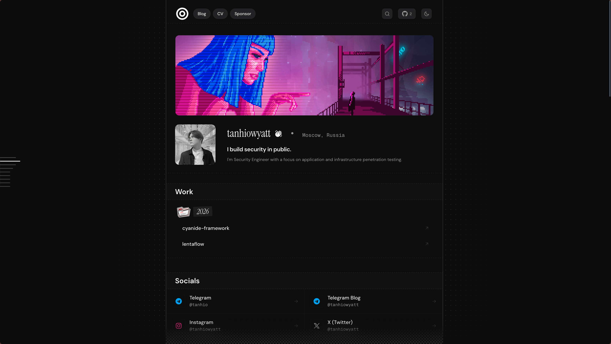

<div align="center">

[](https://opensource.org/licenses/MIT)
[](https://ton.org/)
[](https://www.typescriptlang.org/)
[](https://tailwindcss.com/)

</div>

<div align="center">
  
</div>

<h3 align="center">
  Tanhio.Dev Personal Site
  <br/>
  Modern • Multihost • TON
</h3>

---

### This is the source code for [tanhio.dev](https://tanhio.dev), my personal portfolio.

The site is open source because I want the work to be inspectable, reusable, and easy to learn from.

<div align="center">
  
</div>

## The stack

Built with the tools I use for actual product work:

- **Next.js 16** (App Router, React Server Components, Turbopack)
- **React 19** + **TypeScript 5** (strict)
- **Tailwind CSS v4** + **shadcn/ui** (Radix UI primitives)
- **Motion 12** for animations
- **next-themes** — class-based dark mode
- **date-fns 4** + **date-fns-tz** for dates
- **next-mdx-remote** with Shiki for server-side Markdown/MDX rendering
- **Vercel Analytics** + **Speed Insights** in the root layout
- **PostHog** for server-side analytics and insights
- **TON Connect** for sponsor seat payments (`/api/ton/payment/create`, `/api/ton/claim`)

## 🚀 Features

- **Sponsor Strip**: supporter logos on the home page and `/sponsor`, driven by `config/sponsors.ts` plus paid TON payments.
- **Insights**: visitor trend chart with KPI cards, fetched server-side from PostHog.
- **GitHub Section**: server-fetched contributions and stars, wrapped in Suspense with a skeleton fallback.

## 🛠 Getting Started

### Prerequisites

- Node.js 20+

### Running Locally

1. **Clone the repository:**
   ```bash
   git clone https://github.com/tanhiowyatt/tanhio.dev.git
   cd tanhio.dev
   ```

2. **Install dependencies:**
   ```bash
   npm install
   ```

3. **Start the dev server:**
   ```bash
   npm run dev
   ```

   Go to [http://localhost:3000](http://localhost:3000).

4. **Build for production:**
   ```bash
   npm run build
   npm run start
   ```

## 📁 Project Structure

```text
├── app/                 # Next.js App Router routes (home, project/[id], api/)
├── components/          # UI components (landing, shared, ui, motion-primitives, skeletons)
├── config/              # Typed config layer (site, hero, skills, projects, sponsors, etc.)
├── content/blog/        # Blog posts in MDX
├── lib/                 # Utilities (cn, github, PostHog, TON, markdown, etc.)
├── public/              # Static assets
├── package.json         # NPM scripts and dependencies
└── app/globals.css      # Tailwind v4 + design tokens
```

## 🔒 Security

- **Vercel Analytics + Speed Insights**: wired into the root layout, no client-side tracking without `NEXT_PUBLIC_POSTHOG_KEY`.
- **PostHog**: server-side queries for Insights and visitor count; returns `null` when `POSTHOG_API_KEY` is missing.

## 📄 License

This project is licensed under the [MIT License](./license).
